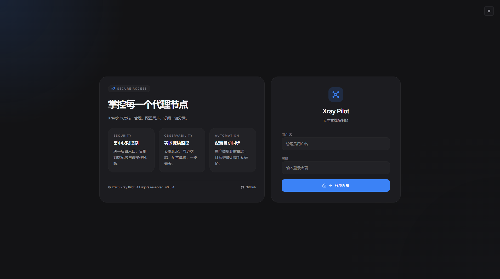
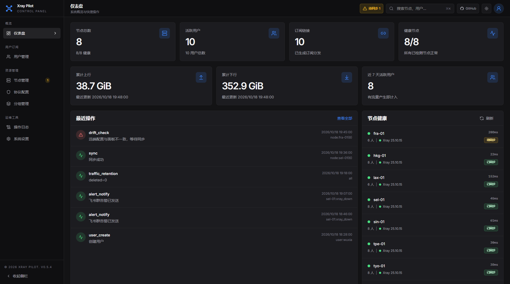
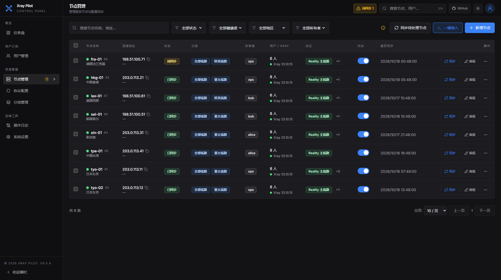
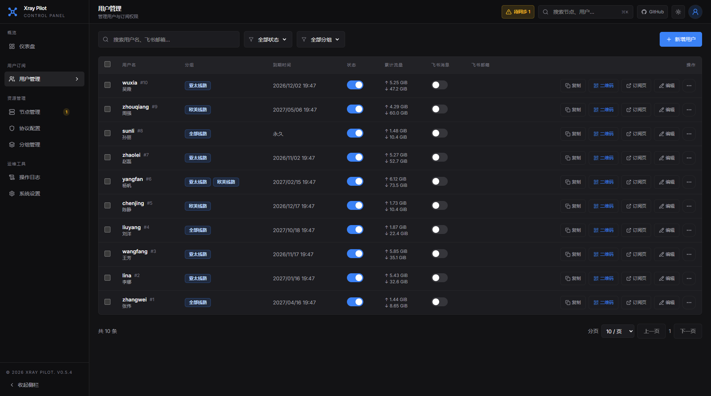
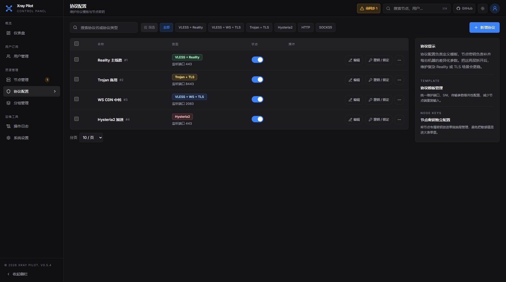
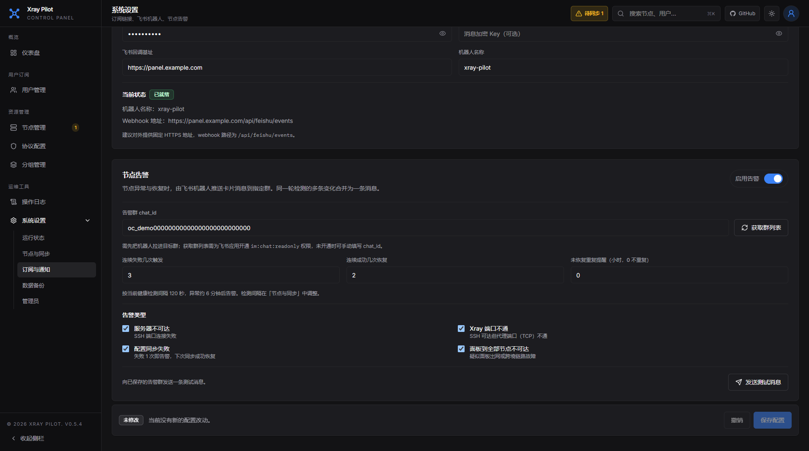
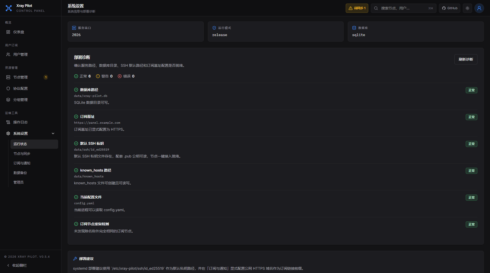
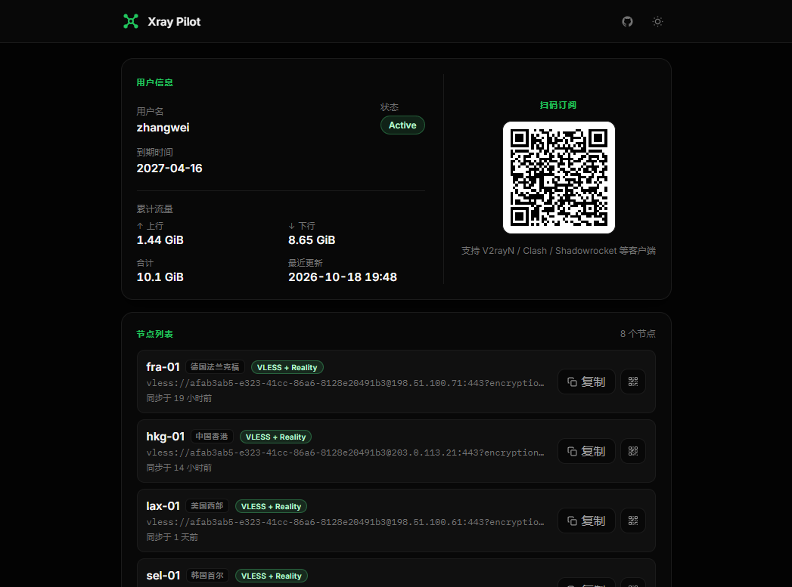

# xray-pilot

Self-hosted Xray node management for small teams. Onboard nodes in one command, push configs over SSH, apply user changes instantly through the Xray gRPC API, and hand out multi-format subscriptions — all from a single Go binary with the web UI embedded.

[中文文档](./README.zh-CN.md)

## Features

- **Multi-protocol nodes**: VLESS + Reality, VLESS + WS + TLS and Trojan inbounds, plus Hysteria2 subscription entries; protocol templates are shared, while ports, SNI and fingerprints can be overridden per node
- **Node onboarding**: a one-line install command registers a fresh VPS with the panel; replacing a server keeps its groups, keys and overrides
- **Config sync**: atomic uploads over SSH, scheduled SHA256 drift detection, and instant user add/remove through the Xray gRPC API without restarting Xray
- **Health checks and alerts**: probes SSH and proxy ports, and posts Feishu group cards when a node goes down, Xray ports close or a sync fails — with recovery notices
- **Subscriptions**: base64 / Clash / sing-box output picked by client, a browser info page with QR codes, traffic usage, and automatic removal of expired users from every node
- **Users and access**: groups decide which nodes a user gets; subscription links can also be delivered through a Feishu bot
- **Ops proxies**: HTTP / SOCKS5 inbounds with IP allowlists and optional auth, kept out of user subscriptions
- **Administration**: multiple admin accounts (super admin / admin), operation logs with actors, scheduled SQLite backups, and runtime settings managed from the web UI
- **Single binary**: the React frontend is embedded via `go:embed`; SQLite by default, PostgreSQL optional

## Screenshots

> The admin UI is in Chinese. Screenshots use fictional demo data.

### Login



Sign in to the control panel; light and dark themes are both supported.

### Dashboard



Node health, active users, cumulative traffic, recent operations and nodes waiting for sync in one view.

### Nodes



Server-side filters by status, health, region and owner; per-node sync state, Xray version, bound protocols and one-click onboarding.

### Users



Manage subscription users, groups and expiry; copy links, show QR codes, check traffic, and push subscriptions through Feishu.

### Protocol Configuration



Protocol templates hold shared settings; node keys hold per-node key material and port overrides.

### Node Alerts



Pick a Feishu group, tune failure / recovery thresholds and alert types, and send a test message.

### System Settings



Runtime diagnostics and deployment hints; scheduler, SSH, subscription, backup and admin settings live in their own sections.

### Subscription Portal



The same `/sub/{token}` endpoint serves a browser info page with QR import, per-node copy and fallback links, or raw subscription content for clients.

## Tech Stack

| Layer | Technology |
| --- | --- |
| Backend | Go 1.26.1+, Gin, GORM, Zap |
| Database | SQLite by default, PostgreSQL optional |
| Auth | JWT bearer tokens, bcrypt |
| Crypto | AES-GCM for secrets at rest, SHA256 for drift checks |
| Frontend | React 19, Vite, TypeScript, Tailwind CSS v4 |

## Installation

### One-line install

Linux `amd64` and `arm64` hosts can install the latest release with:

```bash
curl -fsSL https://raw.githubusercontent.com/imrui/xray-pilot/main/install.sh | sudo bash
```

The installer will:

- detect `amd64` or `arm64`
- download the latest GitHub Release
- verify `checksums.txt`
- install `xray-pilot` to `/usr/local/bin/xray-pilot`
- create `/etc/xray-pilot/config.yaml`
- create `/etc/xray-pilot/ssh/` for service-managed SSH keys
- create and start the `xray-pilot.service` systemd unit
- generate a random admin password, JWT secret, and crypto master key

### Manual install

| Platform | Archive |
| --- | --- |
| Linux amd64 | `xray-pilot_<version>_linux_amd64.tar.gz` |
| Linux arm64 | `xray-pilot_<version>_linux_arm64.tar.gz` |
| macOS amd64 | `xray-pilot_<version>_darwin_amd64.tar.gz` |
| macOS arm64 | `xray-pilot_<version>_darwin_arm64.tar.gz` |

Manual installation steps:

1. Download the matching archive and `checksums.txt` from the latest [GitHub Release](https://github.com/imrui/xray-pilot/releases).
2. Verify the archive with `sha256sum -c checksums.txt --ignore-missing`.
3. Extract the binary and place it in your preferred location.
4. Copy [`config.yaml.example`](./config.yaml.example) to `config.yaml` and adjust the values.
5. Start the service with `./xray-pilot`.

### Node bootstrap

For fresh nodes, use [`scripts/node-bootstrap.sh`](./scripts/node-bootstrap.sh) to prepare SSH access, install Xray, and optionally enable BBR before adding the node to the panel.

Typical flow:

```bash
curl -fsSL https://raw.githubusercontent.com/imrui/xray-pilot/main/scripts/node-bootstrap.sh | sudo bash
```

The script supports interactive public-key input, or you can provide `AUTHORIZED_KEYS` up front for non-interactive usage:

```bash
curl -fsSL https://raw.githubusercontent.com/imrui/xray-pilot/main/scripts/node-bootstrap.sh | \
sudo AUTHORIZED_KEYS=$'ssh-ed25519 AAAA... admin@main\nssh-ed25519 AAAA... root@main' bash
```

The script creates a timestamped backup of `sshd_config` before changing `PermitRootLogin`.

#### Auto-onboarding mode (v0.4.0+, recommended)

If you already run a panel, open the "One-click install" dialog in the node list; it generates a curl command that wires the panel SSH pubkey, installs Xray, and posts the node back to the panel — no need to paste pubkeys or manually add the node afterwards.

```bash
curl -fsSL https://raw.githubusercontent.com/imrui/xray-pilot/main/scripts/node-bootstrap.sh | \
  sudo PANEL_URL=https://your-panel INSTALL_TOKEN=abc123... bash
```

`PANEL_URL` and `INSTALL_TOKEN` come from the dialog. Tokens default to 10-minute TTL, are single-use, and are bound to the first source IP that fetches the panel pubkey. The script falls back to the interactive flow when these variables are absent.

## Upgrade

Existing Linux installations can be upgraded by re-running the installer:

```bash
curl -fsSL https://raw.githubusercontent.com/imrui/xray-pilot/main/install.sh | sudo bash
```

The upgrade process will:

- replace `/usr/local/bin/xray-pilot` with the latest release binary
- keep the existing `/etc/xray-pilot/config.yaml`
- keep the existing `/etc/xray-pilot/ssh/` key directory
- keep the existing SQLite database or external database settings
- reload and restart `xray-pilot.service`

After the upgrade, you can confirm the running version with:

```bash
journalctl -u xray-pilot -n 20 --no-pager
```

## Quick Start From Source

**Prerequisites:** Go 1.26.1+, Node.js 24+

```bash
git clone https://github.com/imrui/xray-pilot.git
cd xray-pilot

make build

cp config.yaml.example config.yaml
# edit jwt.secret and crypto.master_key before first production run

./xray-pilot
```

Open `http://localhost:2026` and sign in with the administrator account defined in `config.yaml`.

## Configuration

Copy [`config.yaml.example`](./config.yaml.example) to `config.yaml`.

```yaml
server:
  port: 2026
  mode: release

database:
  driver: sqlite
  dsn: xray-pilot.db

jwt:
  secret: "change-me-use-a-long-random-string"
  expire: 24

crypto:
  master_key: ""

ssh:
  default_port: 22
  default_user: "root"
  default_key_path: ""
  known_hosts_path: "/var/lib/xray-pilot/known_hosts"

admins:
  - username: admin
    password: "change-me-now"
```

For Linux service deployments, the recommended SSH key location is `/etc/xray-pilot/ssh/id_ed25519`. The service-owned known_hosts file is stored at `/var/lib/xray-pilot/known_hosts`.

Runtime settings such as scheduler intervals, SSH defaults, subscription formatting, and Xray log options are stored in the database-backed system settings table and managed from the web UI.

Admin accounts live in the database since v0.5.0. The `admins` section only seeds the table on first start (the first entry becomes the super admin); afterwards manage accounts from **Settings → Admin accounts**.

Environment variable override:

```bash
XRAY_PILOT_MASTER_KEY=<hex-key> ./xray-pilot
```

Priority order:

1. `XRAY_PILOT_MASTER_KEY`
2. `config.yaml -> crypto.master_key`
3. auto-generated key on first start

## Development

```bash
# backend
make dev-backend

# frontend
make dev-frontend
```

The frontend dev server proxies API requests to `http://localhost:2026`.

## Release Automation

Pushing a tag named `v*` triggers GitHub Actions to:

1. build the frontend with Node 24
2. compile release binaries with Go 1.26
3. package `tar.gz` archives for Linux and macOS on `amd64` and `arm64`
4. generate `checksums.txt`
5. publish a GitHub Release with all artifacts attached

## License

MIT. See [LICENSE](./LICENSE).
